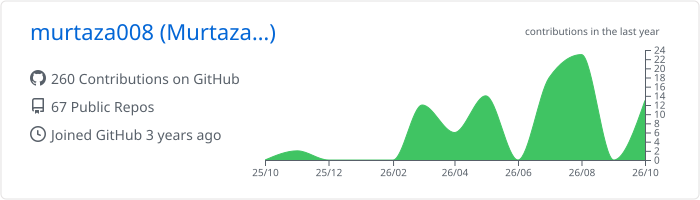
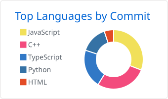
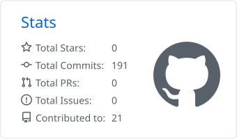

<picture>
  <source media="(prefers-color-scheme: dark)" srcset="./assets/header-dark.svg" />
  <source media="(prefers-color-scheme: light)" srcset="./assets/header-light.svg" />
  
</picture>

[Portfolio](https://murtaza-mazhar-portfolio.vercel.app) &ensp;|&ensp; [LinkedIn](https://www.linkedin.com/in/murtaza-mazhar-04a02b19c) &ensp;|&ensp; [Email](mailto:murtazaaa7798@gmail.com) &ensp;|&ensp; [Fiverr](https://www.fiverr.com/s/kXX3Wkb) &ensp;|&ensp; [Upwork](https://www.upwork.com/freelancers/~01ae9ce4746f975fff)

Hi, I'm Murtaza. I work as an Associate Software Engineer at Webevis Technologies on FlowDish, a multi-tenant restaurant platform. My part of it is the Next.js storefront with live order tracking, a super-admin portal, and permission handling across the Node.js services behind it.

Before that I was at MoinSystems AI, where I built SupportAI. Outside work I build AI products of my own, and a few of them are below. I'm also learning data science, starting with Python and pandas.

I take freelance projects on Fiverr and Upwork: AI chatbots, SaaS MVPs, portfolio sites and bug fixes in full-stack apps. Email works too.

## Projects

### AskData AI
Ask questions about a Postgres database in plain English and get back an answer, a chart and the SQL that produced it. Queries run on a read-only role, only single SELECT statements on known tables get through, and each one times out after 5 seconds.

Next.js, Vercel AI SDK, PostgreSQL, Prisma, Recharts, Vitest 
[Live demo](https://ask-data-ai-ten.vercel.app/) &ensp;|&ensp; [Code](https://github.com/murtaza008/AskData-AI)

### LeadFlow AI
A CRM that scores every lead from 0 to 100 with Gemini, explains the score, and tells you who to follow up with today. It has a drag-and-drop pipeline, automatic follow-up reminders, team roles and Stripe billing.

Next.js, TypeScript, Prisma, Gemini, dnd-kit, Recharts, Stripe 
[Live demo](https://lead-flow-ai-six.vercel.app/) &ensp;|&ensp; [Code](https://github.com/murtaza008/LeadFlow-AI)

### MeetingMind AI
Record a meeting in the browser or upload the audio, and get a transcript with speaker labels, a summary, the decisions made, action items with owners and a draft follow-up email. All of it comes from a single Gemini call.

Next.js, TypeScript, Prisma, Neon Postgres, Gemini, Auth.js 
[Live demo](https://meeting-mind-ai-zeta.vercel.app/) &ensp;|&ensp; [Code](https://github.com/murtaza008/MeetingMind-AI)

### SupportAI
Upload help docs as PDF, DOCX or a URL and get a support agent that answers from them and cites its sources. Retrieval runs on pgvector, answers stream into a chat widget you can embed on any site, and teams get their own workspaces with Stripe billing.

Next.js, TypeScript, Prisma, pgvector, Gemini, Stripe 
[Code](https://github.com/murtaza008/Support-AI)

### Driver Monitoring System
My final-year project at UMT. An Android app detects drowsiness, yawning and phone use on the device itself, using ML Kit and a fine-tuned YOLO11 model (mAP50 0.927). Violations go to a Node.js API and show up on a React dashboard with live GPS tracking.

Kotlin, TensorFlow Lite, YOLO11, React, Node.js, PostgreSQL, Firebase 
[Dashboard](https://driver-monitoring-system-frontend.vercel.app/) &ensp;|&ensp; [Code](https://github.com/murtaza008/driver-monitoring-system)

## Tools I use most

<picture>
  <source media="(prefers-color-scheme: dark)" srcset="https://skillicons.dev/icons?i=ts,js,react,nextjs,nodejs,express,mongodb,postgres,mysql,prisma,tailwind,python&theme=dark" />
  <source media="(prefers-color-scheme: light)" srcset="https://skillicons.dev/icons?i=ts,js,react,nextjs,nodejs,express,mongodb,postgres,mysql,prisma,tailwind,python&theme=light" />
  
</picture>

For AI work: Gemini API, Vercel AI SDK, pgvector and LangChain. For real-time features: Socket.IO.

## Work

| Role | Company | When |
| :-- | :-- | :-- |
| Associate Software Engineer | Webevis Technologies | Jul 2026 – now |
| MERN Stack Developer | MoinSystems AI | Feb 2026 – Jun 2026 |
| Frontend Developer Intern | OptimusFox | Jun 2025 – Aug 2025 |

BS Software Engineering, University of Management and Technology, Lahore

## Activity

<picture>
  <source media="(prefers-color-scheme: dark)" srcset="./profile-summary-card-output/github_dark/0-profile-details.svg" />
  <source media="(prefers-color-scheme: light)" srcset="./profile-summary-card-output/github/0-profile-details.svg" />
  
</picture>

<picture>
  <source media="(prefers-color-scheme: dark)" srcset="./profile-summary-card-output/github_dark/2-most-commit-language.svg" />
  <source media="(prefers-color-scheme: light)" srcset="./profile-summary-card-output/github/2-most-commit-language.svg" />
  
</picture>
<picture>
  <source media="(prefers-color-scheme: dark)" srcset="./profile-summary-card-output/github_dark/3-stats.svg" />
  <source media="(prefers-color-scheme: light)" srcset="./profile-summary-card-output/github/3-stats.svg" />
  
</picture>

<picture>
  <source media="(prefers-color-scheme: dark)" srcset="https://raw.githubusercontent.com/murtaza008/murtaza008/output/github-snake-dark.svg" />
  <source media="(prefers-color-scheme: light)" srcset="https://raw.githubusercontent.com/murtaza008/murtaza008/output/github-snake.svg" />
  
</picture>
